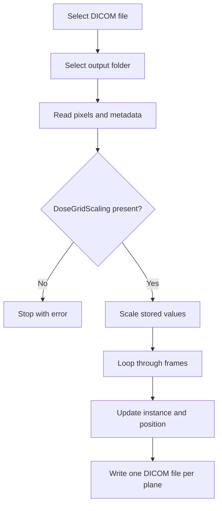

# RT Dose Plane Exporter for MATLAB

`plane.m` is an interactive MATLAB script that reads a multi-frame DICOM RT Dose object and attempts to export each transverse dose plane as an individual DICOM file.

> [!CAUTION]
> This script is suitable for research, development, and quality-assurance testing only. The current implementation does **not** produce independently validated, standards-compliant single-plane RT Dose objects. Review the limitations in this document before using its output in any clinical or quantitative workflow.

## Contents

- [Overview](#overview)
- [Important terminology correction](#important-terminology-correction)
- [Requirements](#requirements)
- [Input requirements](#input-requirements)
- [Installation](#installation)
- [Usage](#usage)
- [Output](#output)
- [Processing workflow](#processing-workflow)
- [Dose scaling](#dose-scaling)
- [Dose-plane geometry](#dose-plane-geometry)
- [Important limitations](#important-limitations)
- [Validation](#validation)
- [Troubleshooting](#troubleshooting)
- [Recommended improvements](#recommended-improvements)
- [Data privacy](#data-privacy)
- [References](#references)
- [License](#license)

## Overview

The script provides a graphical workflow that:

1. Prompts the user to select a DICOM file.
2. Prompts for an output directory.
3. Reads the DICOM pixel data with `dicomread`.
4. Reads the DICOM metadata with `dicominfo`.
5. Checks for the `DoseGridScaling` attribute.
6. Multiplies the stored pixel values by `DoseGridScaling`.
7. Iterates through the dose-grid frames.
8. Updates `InstanceNumber` and `ImagePositionPatient` for each plane.
9. Attempts to write each plane as a separate DICOM file.

The generated filenames follow this pattern:

```text
DosePlane_001.dcm
DosePlane_002.dcm
DosePlane_003.dcm
...
```

The script does not display the dose, export text matrices, create screenshots, calculate DVHs, or associate dose planes with RT Structure Set contours.

## Important terminology correction

The source comments and file-selection dialog refer to a **DICOM RT Plan**. The code actually expects a **DICOM RT Dose** object because it reads pixel data and requires `DoseGridScaling`.

| DICOM object | Typical content | Suitable input? |
|---|---|---:|
| RT Plan (`RTPLAN`) | Beams, control points, prescriptions, machine parameters | No |
| RT Dose (`RTDOSE`) | A scaled 2D or multi-frame dose grid | Yes |
| RT Structure Set (`RTSTRUCT`) | Structure contours and references | No |

Select the treatment-planning system's RT Dose file, not the RT Plan file.

## Requirements

- MATLAB with desktop GUI support.
- Image Processing Toolbox.
- Access to the following functions:
  - `uigetfile`
  - `uigetdir`
  - `dicominfo`
  - `dicomread`
  - `dicomwrite`
- A readable DICOM RT Dose object containing pixel data and `DoseGridScaling`.
- Write permission for the selected output directory.

No third-party MATLAB package is required.

## Input requirements

The intended input is a single multi-frame RT Dose DICOM file.

### Attributes used directly by the script

| DICOM keyword | Purpose in the script | Fallback |
|---|---|---|
| `DoseGridScaling` | Converts stored pixel values to scaled dose values | None; the script stops if absent |
| `ImagePositionPatient` | Supplies the starting patient position | `[0, 0, 0]` |
| `SliceThickness` | Used as a constant increment between planes | `1` mm |
| `InstanceNumber` | Replaced with the loop index in each output | Generated as `1, 2, 3, ...` |

### Attributes that should also be checked

The current script does not validate these important attributes:

- `Modality` — should normally be `RTDOSE`.
- `SOPClassUID` — should identify an RT Dose object.
- `DoseUnits` — commonly `GY`, but may be `RELATIVE`.
- `DoseType` and `DoseSummationType`.
- `NumberOfFrames`.
- `GridFrameOffsetVector`.
- `FrameIncrementPointer`.
- `ImageOrientationPatient`.
- `PixelSpacing`.
- `FrameOfReferenceUID`.
- Referenced RT Plan sequences.
- Pixel representation and bit-depth attributes.

## Installation

Place these files in the same project folder:

```text
project/
├── plane.m
└── README_plane.md
```

Open MATLAB and change the Current Folder to the project directory, or add it to the MATLAB path:

```matlab
addpath('C:\path\to\project')
```

On Linux or macOS:

```matlab
addpath('/path/to/project')
```

## Usage

Run the script from the MATLAB Command Window:

```matlab
plane
```

Then:

1. Select an RT Dose `.dcm` file.
2. Select the destination directory.
3. Wait while MATLAB processes each frame.
4. Review the Command Window for the path of every written file.

Canceling either dialog stops the script without exporting files.

### Typical Command Window output

```text
Saved dose plane 1 to C:\DoseExport\DosePlane_001.dcm
Saved dose plane 2 to C:\DoseExport\DosePlane_002.dcm
Saved dose plane 3 to C:\DoseExport\DosePlane_003.dcm
All dose planes have been exported successfully.
```

The final success message appears only if the loop completes without an uncaught MATLAB error. It does not confirm DICOM conformance or dosimetric correctness.

## Output

Each output file is intended to contain one 2D dose plane.

| Output property | Current behavior |
|---|---|
| Filename | `DosePlane_NNN.dcm` |
| Pixel matrix | `doseArray(:,:,z)` |
| `InstanceNumber` | Set to the 1-based loop index |
| `ImagePositionPatient` | Original x/y and calculated z |
| Remaining metadata | Copied from the source object |
| DICOM write mode | `CreateMode='Copy'` |

Existing files with the same names may be overwritten, depending on MATLAB and filesystem behavior. Use an empty output directory for each dataset.

## Processing workflow



## Dose scaling

The script calculates:

```matlab
doseArray = rtPlan * info.DoseGridScaling;
```

Conceptually:

$$
D(r,c,k) = P(r,c,k) \times S
$$

where:

- $P$ is the stored integer pixel value;
- $S$ is `DoseGridScaling`;
- $D$ is the scaled dose value in the unit declared by `DoseUnits`.

The result should not automatically be described as Gy unless `DoseUnits` confirms `GY`.

### Important output-scaling warning

The script passes the **already scaled** array to `dicomwrite` while copying the original `DoseGridScaling` value. This creates two problems:

1. `dosePlane` is normally a floating-point array, while `dicomwrite` documents integer image types for DICOM pixel data.
2. If scaled values are stored while the original `DoseGridScaling` remains in the metadata, a downstream reader may apply the scale factor again or the write may quantize, clip, or fail.

For RT Dose DICOM output, dose values should be deliberately re-encoded as integer stored values with a matching `DoseGridScaling`, bit depth, and pixel representation. Do not assume the current output preserves the source dose numerically.

## Dose-plane geometry

The script calculates the plane position as:

```matlab
zPosition = imagePositionPatient(3) + (z - 1) * sliceThickness;
```

and then writes:

```matlab
planeInfo.ImagePositionPatient = [x0, y0, zPosition];
```

This assumes all of the following:

- The dose grid is axial/transverse.
- The image row and column axes are aligned with the patient x/y axes.
- All planes are uniformly spaced.
- Plane order follows increasing patient z.
- `SliceThickness` equals the distance between dose planes.

Those assumptions are not valid for every RT Dose object.

### DICOM RT Dose positioning

For multi-frame RT Dose, plane locations are normally defined using `ImagePositionPatient`, `ImageOrientationPatient`, and `GridFrameOffsetVector`. A general plane origin is determined along the normal to the dose plane, not necessarily by adding a value only to patient z.

The current script ignores:

- Oblique or rotated dose grids.
- Descending or negative frame offsets.
- Nonuniform inter-plane spacing.
- Absolute-coordinate forms of `GridFrameOffsetVector`.
- Differences between slice thickness and frame spacing.

The fallback position `[0, 0, 0]` and fallback thickness `1` mm prevent an immediate error but do not create trustworthy spatial geometry.

## Important limitations

| Priority | Limitation | Possible consequence |
|---|---|---|
| Critical | The dialog says RT Plan, but the code requires RT Dose | Users may select the wrong object |
| Critical | Scaled floating-point dose is written with copied scaling metadata | Write failure or incorrect reconstructed dose |
| Critical | Multi-frame RT Dose metadata is copied into a single-plane file without complete cleanup | Internally inconsistent or nonconformant DICOM output |
| High | `GridFrameOffsetVector` is ignored | Incorrect plane locations |
| High | `ImageOrientationPatient` is ignored | Incorrect geometry for rotated or oblique grids |
| High | Original SOP Instance UID may be copied into multiple outputs | Duplicate identifiers and object ambiguity |
| High | `CreateMode='Copy'` does not validate metadata | Invalid combinations of attributes can be written |
| High | `NumberOfFrames`, `FrameIncrementPointer`, and frame-offset metadata are not reconciled | A nominally single-plane file may still describe a multi-frame object |
| Medium | `DoseUnits` is not checked | Relative dose may be mistaken for Gy |
| Medium | Missing geometry is silently replaced by arbitrary defaults | Spatially misleading output |
| Medium | The script does not verify modality or SOP Class | Non-RT-Dose objects may reach later processing |
| Medium | Output filenames are reused on repeated runs | Previous results can be overwritten or mixed |
| Medium | Source patient and treatment metadata are copied | Protected health information remains in every output |
| Low | Variables are not cleared or wrapped in a function | Workspace variables can be replaced |
| Low | There is no manifest or validation report | Traceability is limited |

### RT Dose IOD warning

Splitting a multi-frame RT Dose into independent single-frame RT Dose objects is not equivalent to saving ordinary 2D images. The output metadata, unique identifiers, referenced objects, frame attributes, pixel encoding, and dose geometry must remain internally consistent.

MATLAB's `dicomwrite` supports automatic validation for only a limited set of image IODs. With `CreateMode='Copy'`, metadata is copied without conformance verification. Therefore, successful file creation is not evidence that another DICOM system, treatment-planning system, or QA application will interpret the result correctly.

## Validation

Validate the output before relying on it.

### 1. Confirm the input object

```matlab
info = dicominfo('input.dcm');
disp(info.Modality)
disp(info.SOPClassUID)
disp(info.DoseUnits)
disp(info.DoseGridScaling)
```

Expected modality:

```text
RTDOSE
```

### 2. Inspect the input dimensions

```matlab
rawDose = dicomread(info);
size(rawDose)
```

Compare the detected frame count with `NumberOfFrames` and the number of entries in `GridFrameOffsetVector`.

### 3. Verify numerical dose

For selected pixels and frames, compare:

```matlab
sourceDose = double(rawDose) .* double(info.DoseGridScaling);
```

against the values reconstructed from every exported file. Use several values, including zero, a low-dose region, the maximum, and a clinically relevant point.

### 4. Verify geometry

Compare source and output:

- `FrameOfReferenceUID`
- `ImagePositionPatient`
- `ImageOrientationPatient`
- `PixelSpacing`
- `GridFrameOffsetVector`
- rows and columns
- plane order

Overlay each plane on the referenced CT images in a trusted DICOM-RT viewer.

### 5. Check unique identifiers

Confirm that every independently created DICOM object has an appropriate unique SOP Instance UID and that references remain correct.

### 6. Test interoperability

Open the output in at least one independent DICOM validator or DICOM-RT application. Check for parsing warnings, metadata inconsistencies, incorrect dose units, and spatial shifts.

## Troubleshooting

### “The selected file does not contain dose information”

The selected object does not contain `DoseGridScaling`. Select an RT Dose file rather than an RT Plan, RT Structure Set, CT, or MR file.

### `dicomwrite` rejects the dose plane data type

After multiplication by `DoseGridScaling`, `dosePlane` is usually a floating-point array. DICOM pixel data normally require deliberate integer encoding. Converting blindly to `uint16` is not sufficient unless a suitable new `DoseGridScaling` and matching bit metadata are calculated.

### The number of exported planes is unexpected

Inspect:

```matlab
size(dicomread(inputFilePath))
info.NumberOfFrames
numel(info.GridFrameOffsetVector)
```

The values should be interpreted consistently for the source transfer syntax and multi-frame layout.

### Planes appear shifted or reversed

The script uses `SliceThickness` and assumes increasing patient z. The source may use `GridFrameOffsetVector`, a descending order, or an oblique orientation.

### A DICOM viewer refuses to open the output

The copied multi-frame RT Dose metadata may be inconsistent with the single-plane pixel matrix, or the pixel data type may not match the copied bit-depth metadata.

### Output contains patient information

The script copies source metadata. Perform controlled de-identification with an appropriate DICOM tool and verify that required UIDs and references are handled consistently.

## Recommended improvements

A safer revision should:

1. Rename prompts and variables from RT Plan to RT Dose.
2. Validate `Modality`, SOP Class UID, `DoseUnits`, and essential RT Dose attributes.
3. Read stored pixel data without losing its integer representation.
4. Use `GridFrameOffsetVector` for each frame.
5. Apply `ImageOrientationPatient` to calculate the full 3D plane origin.
6. Reject missing or inconsistent geometry instead of inserting arbitrary defaults.
7. Choose an explicit output model:
   - standards-compliant RT Dose objects;
   - ordinary secondary-capture images for visualization; or
   - non-DICOM numeric export such as MAT, CSV, or HDF5.
8. Re-encode dose values with a documented integer range and matching `DoseGridScaling`.
9. Update or remove all multi-frame attributes as appropriate.
10. Generate new SOP Instance UIDs with `dicomuid` when creating independent objects.
11. Preserve or deliberately update study, series, frame-of-reference, and referenced-plan relationships.
12. Capture the status output from `dicomwrite` and report warnings.
13. Write a manifest containing source UID, output UID, frame index, position, dose scale, units, checksums, and validation status.
14. Add automated numerical and geometry regression tests.
15. Offer a dry-run mode that reports the planned conversion without writing files.

## Data privacy

The script copies the source metadata structure to every output file. This can propagate patient identifiers and other protected health information.

- Use de-identified datasets for development and public repositories.
- Do not upload clinical DICOM files or exported planes to GitHub.
- Keep source and output data in approved institutional storage.
- Verify de-identification independently.
- Be careful when changing UIDs because RT objects depend on cross-object references.

## References

- MathWorks: [`dicomread`](https://www.mathworks.com/help/images/ref/dicomread.html)
- MathWorks: [`dicominfo`](https://www.mathworks.com/help/images/ref/dicominfo.html)
- MathWorks: [`dicomwrite`](https://www.mathworks.com/help/images/ref/dicomwrite.html)
- MathWorks: [`dicomuid`](https://www.mathworks.com/help/images/ref/dicomuid.html)
- DICOM Standard, Part 3: [RT Dose Module](https://dicom.nema.org/medical/dicom/current/output/chtml/part03/sect_C.8.8.3.html)
- DICOM Standard, Part 3: [Image Plane Module](https://dicom.nema.org/medical/dicom/current/output/chtml/part03/sect_C.7.6.2.html)

## License

No license is declared in the attached `plane.m` source. Add a `LICENSE` file before redistributing the script or accepting external contributions.
